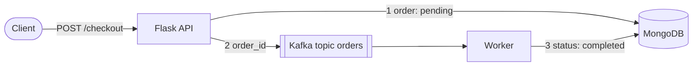

# orders-pipeline-kafka

Order pipeline: a Flask API accepts checkouts, publishes order events to Kafka, and a worker consumer completes them in MongoDB.
Python (Flask), Kafka (KRaft, single broker) and MongoDB, run with Docker Compose.



## Components

| Component     | What it does                                                    | Port  |
| ------------- | --------------------------------------------------------------- | ----- |
| Flask API     | Serves the web page and the REST API, produces to Kafka         | 5000  |
| Worker        | Consumes Kafka, processes the order, marks it completed         | -     |
| Kafka         | Queue between the API and the worker (topic `orders`)           | 9092  |
| MongoDB       | Stores products and orders (database `shop_db`)                 | 27017 |
| Mongo Express | Web UI for MongoDB                                              | 8081  |
| Kafka UI      | Web UI for Kafka                                                | 8888  |

## Data flow

Buy:

```text
Browser -> POST /checkout -> Flask API
   1. validate, look up products, save order in MongoDB (status: pending)
   2. publish {order_id} to Kafka topic "orders"
   3. reply 202
Worker <- Kafka
   4. do the work (simulated, 5s)
   5. set order status to completed in MongoDB, then commit the offset
```

List purchases:

```text
Browser -> GET /api/getAllBoughtItems?user_id=u1 -> Flask API -> MongoDB
```

Notes:

- Only the `order_id` goes through Kafka. The order itself is already in MongoDB.
- The worker commits the Kafka offset after the update, so a crash re-delivers the message.
- Only `pending` orders are updated, so a repeated message does nothing.
- If Kafka is down at checkout, the order is marked `failed`.

## Constraints

- Single broker with replication factor 1 and no TLS or SASL; production needs three brokers, replication factor 3 and authenticated listeners.
- MongoDB runs without authentication on a local volume; use a replica set with credentials outside local development.
- The worker simulates processing with a 5 second delay.

## Data

`products`: `sku`, `name`, `price`, `created_at`

`orders`: `order_id` (unique), `user_id`, `items[]` (product_id, product_name, quantity,
price_at_purchase), `total_amount`, `status` (pending, completed, failed), `created_at`

## Structure

```text
.
├── docker-compose.yml     # all services
├── Makefile               # shortcuts, run `make`
├── api/
│   ├── app.py             # Flask app, /checkout, Kafka producer
│   ├── db.py              # MongoDB connection
│   ├── models/            # pydantic models (product, order)
│   ├── routes/            # /api/products, /api/orders, /api/getAllBoughtItems
│   ├── bootstrap/         # seed script
│   ├── templates/         # index.html
│   └── static/            # style.css
└── worker/
    ├── worker.py          # Kafka consumer
    └── db.py
```

## Run

```bash
make up      # build and start everything
make seed    # load 20 sample products
```

Open <http://localhost:5000>, click Buy, and watch the order go from pending to completed.

```bash
make logs               # follow logs (make logs s=order-worker for one service)
make down               # stop and remove containers, keeps data
make nuke               # also delete MongoDB and Kafka data
```

Faster development: `make infra` (only MongoDB and Kafka in Docker), then `make api` and
`make worker` in two terminals. Run `make` to list all commands.

## API

| Method | Path                                 | Description                          |
| ------ | ------------------------------------ | ------------------------------------ |
| GET    | `/`                                  | Product page                         |
| GET    | `/api/products`                      | List products                        |
| GET    | `/api/products/<id>`                 | One product                          |
| POST   | `/api/products`                      | Create a product                     |
| POST   | `/checkout`                          | Create an order (async, returns 202) |
| GET    | `/api/getAllBoughtItems?user_id=...` | A user's orders and items            |

```bash
curl -X POST localhost:5000/checkout -H 'Content-Type: application/json' \
  -d '{"user_id": "u1", "items": [{"product_id": "<product _id>", "quantity": 1}]}'

curl "localhost:5000/api/getAllBoughtItems?user_id=u1"
```

Errors: 400 bad JSON or id, 404 unknown product, 422 invalid payload, 503 Kafka unavailable.
